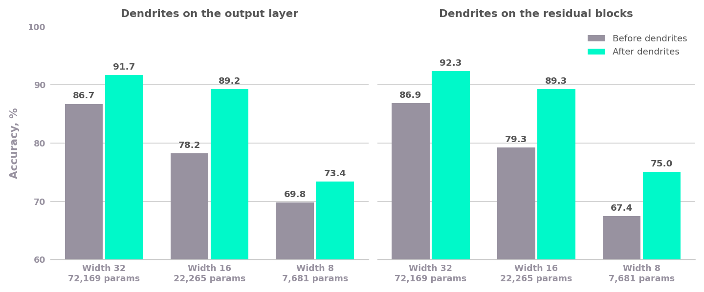

# Detailed Report: Dendrites on a 1D ResNet for ECoG Tone Decoding

## Summary

- With dendrites on the output layer, validation balanced accuracy rose from 87.4% to 92.8% (3 seeds, every seed improved), for at most 2.2% more parameters.
- Dendrites raised validation accuracy at every model size tried. That covers the full-size model with dendrites on the output layer or on the residual blocks, and versions at half and a quarter of the width: all 18 of those runs improved.

## Task and data

[BrainStorm 2026 Track 1](https://huggingface.co/datasets/PrecisionNeuroscience/BrainStorm2026-Track1) (Precision Neuroscience) is a 1024-channel ECoG recording from one anesthetized pig listening to a sequence of tones, sampled at 1 kHz. The task is to label every millisecond as one of 8 tones or silence (9 classes), using only the signal up to that millisecond.

- **Small data.** Train is 90.4 s (164 tone presentations) and validation 22.6 s (46 presentations, about 6 per class). One misclassified tone moves validation balanced accuracy by about 2 points.
- **Validation is the evaluation set.** The public test split contains no real neural signal, so every model scores chance (about 11%) on it. All scores here are validation balanced accuracy, which is also used for early stopping and for choosing the best epoch.
- **Fixed tone order.** Tones start every 500 ms and cycle through the same 8 frequencies. The long model (1.6 s of history) can use the previous tone as context, while the short model (267 ms) sees only the response to the current one.

## Model

The 1024 channels are reduced to 32 with a PCA fitted on the training data, each component scaled to unit variance. A causal stem convolution (kernel 15) is followed by residual blocks. Each block has two dilated causal convolutions (kernel 3) with batch norm, ReLU, dropout 0.2 and an identity skip. A 1x1 convolution head then outputs 9 class logits every millisecond. Every convolution is left-padded, so no output depends on the future.

| Configuration | Dilations | History | Width | Parameters |
|---|---|---|---|---|
| Long (default) | 1, 2, 4, 8, 16, 32, 64, 128, 150 | 1,635 ms | 32 | 72,169 |
| Short | 1, 2, 4, 8, 16, 32 | 267 ms | 32 | 53,353 |
| Long, width 16 | as long | 1,635 ms | 16 | 22,265 |
| Long, width 8 | as long | 1,635 ms | 8 | 7,681 |

Dendrites go either on the head only (`--perforate head`, the default) or on whole residual blocks plus the head (`--perforate blocks`). At width 32, a dendrite set costs about 300-330 parameters on the head and about 57,000 on the blocks.

## Training

Both scripts share the data, model and training step:

- AdamW, learning rate 1e-3, weight decay 1e-2.
- ReduceLROnPlateau on validation balanced accuracy: factor 0.5, patience 6.
- 25 steps per epoch. Each step is a batch of 32 random chunks of `receptive field - 1 + 512` samples, and the last 512 timesteps of each chunk, which all have a full history, are supervised.
- Class-weighted cross-entropy (inverse class frequency, normalized to mean 1) and gradient clipping at 1.0.

The difference is how training ends:

- **Original (`resnet1d.py`):** early stopping after 20 epochs without improvement (at most 200 epochs), keeping the best epoch.
- **PerforatedAI (`resnet1d_perforatedai.py`):** after 10 epochs without improvement, PerforatedAI reloads the best network, adds a dendrite set, and the script starts a new optimizer and scheduler. A set that doesn't improve the score is removed. PerforatedAI ends training after 2 such failed tries, or after 5 sets, and keeps the best network.

## Results

This is the long model with dendrites on the head, seeds 0-2, run with the scripts in this folder. Validation balanced accuracy, %.

| Seed | Original | Before dendrites | After dendrites | Dendrite sets | Parameters | Epochs (original / dendrites) |
|---|---|---|---|---|---|---|
| 0 | 86.9 | 84.5 | 90.9 | 2 | 72,790 | 67 / 105 |
| 1 | 87.1 | 86.1 | 93.7 | 5 | 73,789 | 54 / 442 |
| 2 | 88.2 | 87.1 | 93.6 | 3 | 73,114 | 35 / 181 |
| **Mean** | **87.4** | **85.9** | **92.8** | | | |

- Accuracy rose by 5.4 points over the original model and by 6.9 points over the same run before its first dendrites.
- The 2-5 dendrite sets added 0.9% to 2.2% to the parameter count.
- "Before dendrites" is below the original because PerforatedAI adds the first set after 10 epochs without improvement, while the original waits 20 before stopping.

## Other model sizes

The same model was also run at half and a quarter of the width, with dendrites on the head or on the residual blocks. These runs used the study code this example was extracted from, which has the same model and training recipe, with 3 seeds each. "Before dendrites" is the best validation score before PerforatedAI added the first set. Every one of the 18 runs improved.

| Width | Dendrites on | Parameters before | Parameters after | Before dendrites | After dendrites | Gain |
|---|---|---|---|---|---|---|
| 32 | head | 72,169 | 72,790-73,447 | 86.7 | 91.7 | +5.0 |
| 32 | blocks | 72,169 | 302,119-360,349 | 86.9 | 92.3 | +5.5 |
| 16 | head | 22,265 | 22,598-22,967 | 78.2 | 89.2 | +11.0 |
| 16 | blocks | 22,265 | 82,007-97,325 | 79.3 | 89.3 | +10.0 |
| 8 | head | 7,681 | 7,762-7,978 | 69.8 | 73.4 | +3.6 |
| 8 | blocks | 7,681 | 11,506-28,021 | 67.4 | 75.0 | +7.6 |

## Reproducing

    pip install -r requirements.txt
    for seed in 0 1 2; do
        python resnet1d.py --seed $seed --out original_$seed.json
        python resnet1d_perforatedai.py --seed $seed --out pai_$seed.json
    done

PerforatedAI writes its graphs and checkpoints to a `PAI` folder in the working directory, and reads settings from an existing `PAI/PAI_config.json` there, so run each seed in its own directory. Other configurations: `--width 16` or `--width 8`, `--perforate blocks`, and `--memory short`.

The numbers above come from one NVIDIA L4 GPU per run with Python 3.11, torch 2.6.0 and perforatedai 3.2.9. Including data loading, an original run took 30-40 seconds and a dendrite run 3-13 minutes.
