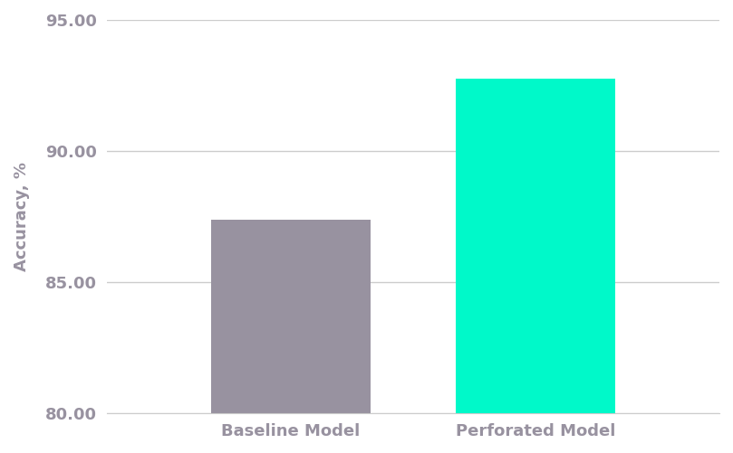

# 1D ResNet on BrainStorm ECoG With Dendrites

This example adds dendrites to a causal dilated 1D ResNet that decodes which of 8 tones an anesthetized pig is hearing, every millisecond, from a 1024-channel ECoG array ([BrainStorm 2026 Track 1](https://huggingface.co/datasets/PrecisionNeuroscience/BrainStorm2026-Track1), Precision Neuroscience). resnet1d.py is the original model with normal training and resnet1d_perforatedai.py is the same model with the changes to add dendrites.

The data (90.4 s of training and 22.6 s of validation recording) is downloaded from Hugging Face on the first run. The public test split contains no real neural signal, so the reported score is validation balanced accuracy.

## Installation

Install the required packages with:

    pip install -r requirements.txt

## Running

Run original with:

    python resnet1d.py

Run dendritic model with:

    python resnet1d_perforatedai.py

Each script takes `--seed`, `--memory short|long`, `--width` and `--out results.json`, and the dendritic script also takes `--perforate head|blocks`. A GPU is recommended: on an NVIDIA L4 the original takes under a minute and the dendritic model 3 to 13 minutes. On Windows, set `PYTHONUTF8=1` if you redirect the output to a file.

## Outcomes:

Validation balanced accuracy of the original and dendrite-optimized networks, mean of 3 seeds:

With dendrites on the output layer, validation balanced accuracy rose from 87.4% to 92.8%, and every seed improved. Each run kept 2 to 5 dendrite sets, adding 621 to 1,620 parameters (at most 2.2% of the model). See [DetailedReport.md](DetailedReport.md) for the per-seed results and other model sizes.
